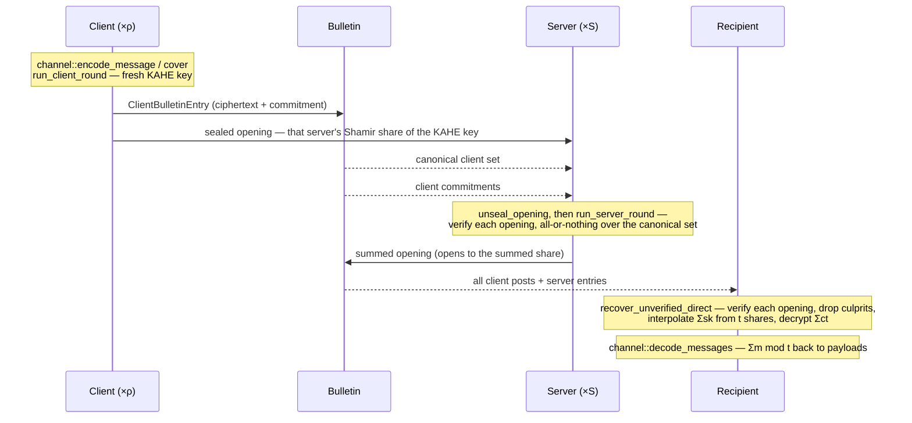

# Panetière

[](https://codecov.io/gh/flashbots/panetiere)

This repository is a reference implementation of **Panetière: Efficient Anonymous Broadcast**, an efficient anonymous broadcast
protocol. Clients each publish one message; a threshold of servers cooperates to
reveal the *sum* of the clients' encrypted vectors and nothing else, and an application-side
encoding turns that sum back into the individual messages. Not audited — do not use in production.

This file is the integration guide: architecture, roles, and the call sequence.
Tests and benchmarks are in [TESTING.md](TESTING.md).

The protocol requires authenticated, consistent broadcast delivery: callers must
supply the same unmodified client posts, bound to their sender and session, to
all participants. The library does not implement that channel.

Ring arithmetic comes from [negacyclic-rings](https://github.com/Ruteri/negacyclic-rings).
[Chipmunk](https://github.com/Ruteri/Chipmunk) supplies the Ring-SIS hash and
Merkle tree used by the commitment layer.

## Roles

- **Client** — encrypts its vector under a fresh KAHE key, Shamir-shares *that
  key* across the servers, and commits to the shares. Each share rides an
  ML-KEM-sealed envelope to its server: the key material is what matters, the
  envelope is only transport. Clients run inside a TEE, but a client that breaks TEEs
  costs liveness, not privacy; the client image lives in [github.com/flashbots/flashbots-images](https://github.com/flashbots/flashbots-images).
- **Server** — holds one Shamir share of every client's KAHE key. It publishes
  the sum of the openings of those shares. The summed opening verifies against
  the summed commitment and opens it to the sum of the shares.
- **Recipient** — verifies the openings, which gives it each server's summed
  share, interpolates $\sum sk$ from any $t$ of them, decrypts $\sum ct$,
  decodes.

Any $t$ shares reconstruct $\sum sk$, so **anonymity needs enough servers to refuse
to decrypt over any client set other than the canonical one — at least
$S - t + 1$ of them.** The canonical set is a slice the caller supplies; the verifier
only checks that the servers it counts agree on it. `ProtocolParams::min_clients` and
`SetPolicy::min_clients` set its minimum size. Recovery enforces
`ProtocolParams::max_clients`, derived from the commitment and KAHE noise budgets
(300 with default parameters, potentially lower with custom parameters). `SetPolicy::max_clients` can tighten this cap, not raise it.

## Architecture

Everything over the ring arithmetic is linear in the payload — encryption,
commitment and the payload encodings all commute with summation,
which is what makes the round work. Panetière owns its ring parameters and thin
semantic types in `src/rings.rs`; `negacyclic-rings` provides the arithmetic.
The layers above are, bottom-up, the schemes (`kahe`, `sss`, `cs`, `pke`), the round
drivers under `protocol::`, and the payload encodings a caller picks between
(`channel`, `mse`, `prony`), which all produce and consume
`Vec<KahePoly>`. Only `protocol`, `bulletin`, `channel` and `pke` are public;
the schemes underneath are internal.

| Module | |
|---|---|
| `kahe` | key-additive homomorphic encryption, plus the CS↔KAHE bridge |
| `sss` | Shamir *t*-of-*n* sharing over the CS ring |
| `cs` | additive vector commitment with addition hiding; `Opening` wire form |
| `pke` | ML-KEM-768 + AES-GCM envelopes for the key shares |
| `bulletin` | published entry types and their byte encodings |
| `protocol::*` | the round drivers, verifier, recipient policy |
| `channel` | recommended payload layer: sizes either encoding for up to $C$ messages of $n$ bytes |
| `mse` / `prony` | the two multiset encodings (peeling; MDS sketch) |

## Ingress

Each client posts its ciphertext and commitment, and the recipient downloads
all of them. That download is the bottleneck — at the reference cell below it
is 2.12 GB per round (300 clients × 7.06 MB of ciphertext) against 0.14 GB of
key-share envelopes, and 6.15 GB with the peeling encoding in place of the
sketch.

## Integration

One direct round, end to end:



### Setup

```rust
let pp = ProtocolParams::setup(&mut rng, n_servers);              // or setup_with_kahe_dims
let server_key = pke::PrivateKey::generate(&mut rng);              // one per server
let servers: Vec<(ServerId, pke::PublicKey)> = /* ordered by ServerId */;
let session = SessionId::new(/* 32 fresh bytes */);
```

Every `setup*` uses the Shamir threshold `honest_majority_threshold(γ) = ⌊γ/2⌋ + 1`
for γ servers (the paper's *t*<sub>s</sub>): anonymity and output delivery both
hold as long as the honest servers are a majority. `.with_threshold(t)` sets
another threshold on any of them; a threshold *t* gives anonymity against *t* − 1
corrupt servers and output delivery against min(*t* − 1, γ − *t*).

`ProtocolParams` is the CRS — every party must use the same instance (derive it
from a shared seed). `ServerId::new(i)` is the server's index into that set.
**`SessionId` must be unique per execution:** sealed
openings are bound to `(sid, client_id, server_id)` as AEAD associated data, so
reuse lets an envelope be replayed from one round into another.

### Payload layer

This fixes $\mu_\mathrm{kahe}$. Every client contributes exactly `pp.message_polys()`
polys, real or cover — `channel::cover(&ch)` builds a cover contribution.

`channel` is the default: it sizes an encoding from "at most $C$ senders, $n$
bytes each", does the byte↔symbol packing, and derives matching
`ProtocolParams`. The capacity $C$ is the most messages one round can carry:
the number of clients, or fewer when some of them only send cover traffic. The
peeling table is the smallest one whose decoding fails with probability at most
$2^{-40}$ at that capacity.

```rust
let ch = ChannelParams::for_messages(capacity, message_bytes, prf_key);  // peeling
let pp = ch.protocol_params(&mut rng, n_servers);       // KAHE width == ch.n_polys()

let mine = channel::encode_message(&mut rng, &ch, &sid, payload)?;   // or channel::cover(&ch)
// ... round ...
let msgs: Vec<Vec<u8>> = channel::decode_messages(&ch, &sid, &plaintext, Some(active))?;
```

`channel` implements the paper's one-shot protocol: each element it inserts is
$(s, m \oplus \mathrm{RO}(s))$ for a nonce $s$ drawn from the caller's cryptographically secure RNG,
with $\mathrm{RO}(s) = \mathrm{SHAKE256}(\texttt{"panetiere/ro-mask/v1"} \| \mathit{sid} \| s)$,
and decoding unmasks every element and returns the messages sorted. Each byte
message carries a length header, so trailing zero bytes survive the padding. The masking is what allows the security proof to fix the corrupted clients' inputs before the honest messages are known. The honest messages themselves are hidden by the encryption. The nonce is sized so that $\rho(Q + \rho)/|N| \le 2^{-128}$ with
$Q = 2^{64}$ oracle queries at the largest round of $\rho = 300$ clients: six
extra 34-bit symbols per element.

`ChannelParams` covers both multiset encodings behind that one interface:
`for_messages` / `for_symbols` build the peeling variant,
`prony_for_messages` / `prony_for_symbols` the Vandermonde
sketch. The sketch is \~3× smaller per client, hence \~3× less ciphertext to move;
recovery is all-or-nothing for both. The sketch also needs a
prime plaintext modulus, which `protocol_params` handles by selecting
`PRONY_PRIME` for that variant. Its keys and payload are elements of
$F_{t^2} = F_t[Z]/(Z^2 - 3)$, two plaintext slots each, so two of $C$ keys
collide with probability at most $C^2/t^2$ (about $2^{-51.5}$ at $C = 300$).

### Client

```rust
pub fn run_client_round<R: CryptoRng + Rng>(
    rng: &mut R, pp: &ProtocolParams, sid: &SessionId, client_id: ClientId,
    message: Vec<KahePoly>, servers: &[(ServerId, pke::PublicKey)],
) -> ClientRoundOutput;               // client_id(), post(), sealed_openings(), into_parts()

ClientRound::new(...).finalize(&message) -> ClientRoundOutput;
```

The expensive message-independent work can run ahead using opaque client rounds:

```rust
let round = ClientRound::new(&mut rng, &pp, &next_session, client_id, &servers);
// At the fixed emission point, for both real and cover traffic:
let output = round.finalize(&message);
```

This moves key generation, zero encryption, Shamir sharing, the key-share
commitment, and sealed openings out of the message-critical path. `ClientRound`
exposes no publishable fields; `finalize` consumes it and must run at the
same scheduled point for real messages and covers.

Publish `post()`; send `sealed_openings()[i]` to server
`i` over any channel (already CCA2-sealed and context-bound). Each envelope holds a commitment
`Opening` whose committed value is that server's Shamir share of the KAHE key —
that share is the secret, the envelope only carries it. `servers` must be
ordered by `ServerId`, and
`sealed_openings()` comes back in that order. The key is fresh per round — a hard
requirement of the scheme.

### Server

```rust
let op = unseal_opening(&server_key, &session, client_id, server_id, sealed)?;  // Option
let entry = run_server_round(
    &pp,
    &ServerInbox::new(server_id, items),
    canonical,
    commitments,                          // each client's post.commitment(), off the bulletin
)?;
```

Before summing, the server checks every canonical client's opening against
that client's own commitment at the server's position, as the paper's server
step does. A failing opening returns `ServerRoundError::BadOpening(client)` and
the server posts nothing, so a misbehaving client can never make an honest
server's aggregate fail at the recipient; the named client can be dropped and
the round re-run without it.

The round is **all-or-nothing over `canonical`**: a client in the set with
nothing in the inbox, or no commitment on the bulletin, returns
`ServerRoundError::MissingClient` rather than summing a smaller set, because
$\sum sk$ and $\sum ct$ must cover exactly the same clients or decryption yields
noise. Extra inbox entries are ignored, so the same round can be re-run over any
subset of what arrived. `unseal_openings` is the batch form.

### Recipient

`protocol::recipient` owns the canonical-set rule and drops faulty servers
instead of failing the round.

```rust
let policy = SetPolicy::anchored(&announced, min_clients, pp.max_clients());
let recovered =
    recover_unverified_direct(&pp, &policy, |cid| bulletin.get(cid), &server_outputs)?;
// recovered.canonical(), recovered.plaintext(), recovered.culprits()
```

Decoding is strictly over the canonical client set: servers that shared over
any other set do not count towards $t$. `culprits` are the servers excluded to
reach the threshold. `recover_unverified_once` is one attempt over a caller-named set with
no exclusion.

The plaintext is $\sum m_i \bmod t$ as `KahePoly`s, which goes straight back
to the payload layer.

## Errors

One `VerifyError` variant is server-attributable and carries an index into
`server_outputs`: `InvalidServerOpening(i)`. The
`recover_*` functions act on exactly those, excluding and retrying until $t$
remain; everything else fails the round. A rejected round comes back as
`RecipientError::Rejected(RejectReason)`, so a caller can report *why* rather
than "no output". `RecipientError::BelowShareThreshold` is expected early in a
round and is worth demoting to trace level.

On the payload side, an over-subscribed peeling table surfaces as
`ChannelError::PeelStalled`. The sketch is the paper's Newton–Girard
encoding, which only guarantees a correct decoding for at most $C$ elements
from honest clients, and its decoder does not detect every round outside that:

- More contributors than the capacity make `Λ` fail to split, which surfaces
  as `ChannelError::SketchFailed(PronyError::NotSplit)`. With honest
  contributors, `Λ` still splits with probability about 1/C!, and the round
  then decodes to garbage.
- A malicious client can change payload cells, and the round then decodes to
  garbled messages. Below capacity, the payload columns the solve did not use
  usually catch this as `PronyError::CheckFailed`. In a full round, with
  exactly $C$ contributors, there are no such columns, so nothing does, and a
  malicious client can add elements to make a round full.
- Malicious contributions can also cancel each other out and look like an
  empty round.

Detecting every incorrect decoding would need a check above the encoding, such
as a tag on each element, which is not part of the construction. A
peeling table that is not an honest sum comes back as
`ChannelError::MalformedEncoding(MseError::{OverCapacity, KeyMismatch})`: the
decoder checks, as the paper's does, that each peeled key hashes to the cell it
was read from and stops after `capacity` elements, so a forged contribution
costs the recipient at most `capacity` peels.
A `None` from
`unseal_opening` is wrong session, wrong client/server, or a tampered envelope.

Nothing that arrives over the wire can panic a peer. Every remote input is
validated and rejected by value: `PackedOpening::from_bytes` and
`Opening::from_packed` bound the declared header before allocating,
`Cs::sum_openings` returns `None` if the openings disagree on shape or position,
`ShamirSharing::recover` checks index range and
distinctness, and the verifier rejects an out-of-range or duplicated
`ServerId` before using it. The `assert!`s that remain are on locally
supplied arguments — parameter constructors (`ShamirParams::new`,
`MseParams::new`, `PronyParams::new`) and payload arity in
`MseEncoding::insert` / `PronySketch::insert` — where a violation is a
caller bug, not an attack. Range checks on the ring bridges are `debug_assert!`,
so they only run in the debug test profile.

## Wire formats

The crate serialises the crypto objects and nothing else — framing, transport,
retries and authenticated delivery are the caller's.

- `ClientBulletinEntry::{to_bytes, try_from_bytes}`.
- `ServerBulletinEntry::{to_bytes, try_from_bytes}`; encoding takes the
  `ProtocolParams`, since the aggregated opening is bit-packed against the
  bounds for its client count.
- `pke::{PublicKey, PrivateKey}::{to_bytes, try_from_bytes}`.
- Sealed openings are already bytes (`ClientRoundOutput::sealed_openings`), opened
  with `unseal_opening`.
- `round_wire_sizes(n_servers, ctxt_polys, rho)` budgets a round without
  sampling a CRS.

`bulletin::InMemoryBulletin` is a `Mutex`-backed vector for tests and the demo —
no persistence, ordering or authentication. It is not a bulletin board.
