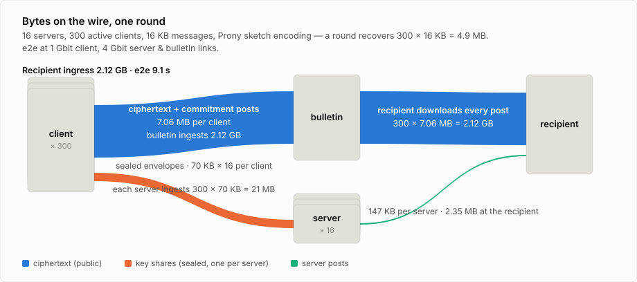

# Tests and performance

How to test and benchmark Panetière, and what it measured.

## Tests and benches

Add all the target architectures:

```sh
rustup target add x86_64-unknown-linux-gnu aarch64-unknown-linux-gnu riscv64gc-unknown-linux-gnu
```

```sh
RAYON_NUM_THREADS=8 cargo test -j 8
RAYON_NUM_THREADS=8 cargo bench -j 8 --bench protocol_sweep   # (S, ρ) × encoding sweep
```

KAHE runs on a single 64-bit NTT over its prime modulus; the CS auxiliary
domain uses a two-prime RNS parameter set from `src/rings.rs`, whose 32-bit NTT
channels dispatch to scalar, AVX2, or NEON. CS and Prony retain their semantic
prime fields.

The integration tests are the executable spec: `end_to_end.rs` (canonical round,
*t*-of-*n*, replay/tamper/norm rejection, anonymity floor, thread
invariance), `mse_e2e.rs` and `prony_e2e.rs` (each encoding carried end-to-end,
with cover traffic), `recipient_e2e.rs` (anchor admission, culprit exclusion, every `RejectReason`).

The sweep binary takes its cells from the environment (`SWEEP_CLIENTS=300x300`,
`SWEEP_PAYLOAD_SYMBOLS`, `SWEEP_THRESHOLD`, `BENCH_BUDGET_SECS`) and
writes one CSV row per cell to `BENCH_CSV`. `BENCH_ROLES` selects which roles a run *records* — the
full round executes either way, so a client measured in a TEE and everything
else measured on the host walk identical code:

```sh
taskset -c 0-7 env RAYON_NUM_THREADS=8 BENCH_ROLES=server,verifier,agg \
    BENCH_CSV=host.csv ./target/release/panetiere_scaling
RAYON_NUM_THREADS=8 BENCH_ROLES=client BENCH_CSV=tdx.csv ./panetiere_scaling   # in the VM
./target/release/panetiere_merge tdx.csv host.csv merged.csv
```

`panetiere_merge` splices at row level — it re-runs the cost model over the
spliced timings, refuses runs with differing thread counts, and asserts the
exact-arithmetic sizes agree, so a mismatch means the runs describe different
cells.

### Lint

CI also checks formatting and runs clippy:

```sh
rustup component add rustfmt clippy
cargo fmt --all --check
RUSTFLAGS="" cargo clippy --target x86_64-unknown-linux-gnu --all-targets -- -D warnings
RUSTFLAGS="" cargo clippy --target aarch64-unknown-linux-gnu --all-targets -- -D warnings
```

`RUSTFLAGS=""` overrides a local `target-cpu=native`.

### Other architectures

Emulate other architectures with qemu. On Ubuntu 26.04:

```sh
sudo apt install qemu-user
```

For each architecture other than your own, install its linker and C library,
edit the linker and runner in `~/.cargo/config.toml` and run the tests.

To emulate x86-64:

```sh
sudo apt install gcc-x86-64-linux-gnu libc6-dev-amd64-cross
```

```toml
[target.x86_64-unknown-linux-gnu]
linker = "x86_64-linux-gnu-gcc"
runner = "qemu-x86_64 -L /usr/x86_64-linux-gnu"
```

```sh
RUSTFLAGS="" cargo test --target x86_64-unknown-linux-gnu
```

To emulate aarch64:

```sh
sudo apt install gcc-aarch64-linux-gnu libc6-dev-arm64-cross
```

```toml
[target.aarch64-unknown-linux-gnu]
linker = "aarch64-linux-gnu-gcc"
runner = "qemu-aarch64 -L /usr/aarch64-linux-gnu"
```

```sh
RUSTFLAGS="" cargo test --target aarch64-unknown-linux-gnu
```

To emulate riscv64:

```sh
sudo apt install gcc-riscv64-linux-gnu libc6-dev-riscv64-cross
```

```toml
[target.riscv64gc-unknown-linux-gnu]
linker = "riscv64-linux-gnu-gcc"
runner = "qemu-riscv64 -L /usr/riscv64-linux-gnu"
```

```sh
RUSTFLAGS="" cargo test --target riscv64gc-unknown-linux-gnu
```

## Performance

Measured on a 16-core 3.9 GHz Intel Xeon Gold 6526Y with 503 GB of memory,
Ubuntu 26.04 / kernel 7.0.0-22, TDX enabled. The client runs in an 8-vCPU,
64 GB TDX VM under QEMU on the same host; every workload is core-pinned,
including the VM's vCPUs, and everything uses 8 threads.

These numbers predate the switch to the honest-majority threshold and were measured
with max(⌊γ/2⌋ + 1, γ − 2), i.e. 6 of 8 and 14 of 16 servers
(`SWEEP_THRESHOLD=S-2`).

### CPU and bytes per round

Prony sketch encoding (`channel` / `prony`), 8 servers. "300 / 100"
is cover traffic: 300 clients in the anonymity set, 100 of them sending.

| Message | Clients | Client | Server | Recipient | Cl→Srv | Cl→Rec | Srv→Rec | Rec. ingress |
|---|---|---|---|---|---|---|---|---|
| 4 KB | 100 | 35.2 ms | 15.7 ms | 30.5 ms | 0.47 MB | 0.61 MB | 109 KB | 0.06 GB |
| 4 KB | 300 / 100 | 25.5 ms | 43.7 ms | 32.5 ms | 0.47 MB | 0.61 MB | 124 KB | 0.18 GB |
| 4 KB | 300 | 51.4 ms | 48.0 ms | 154.7 ms | 0.47 MB | 1.78 MB | 124 KB | 0.54 GB |
| 16 KB | 100 | 52.8 ms | 17.8 ms | 49.4 ms | 0.47 MB | 2.37 MB | 109 KB | 0.24 GB |
| 16 KB | 300 / 100 | 40.6 ms | 44.8 ms | 61.1 ms | 0.47 MB | 2.37 MB | 124 KB | 0.71 GB |
| 16 KB | 300 | 85.3 ms | 50.4 ms | 265.8 ms | 0.47 MB | 7.06 MB | 124 KB | 2.12 GB |

### Simulated network throughput

16 servers, 300 × 16 KB, one-way latency 60 ms + U[0, 10) ms per
message. e2e is measured CPU wall plus simulated transfer; MB/s is the recovered
payload (4.9 MB) over e2e. Peeling carries \~3× these bytes and lands at roughly
a third of these rates.

Prony sketch:

| Links, client / server / bulletin (Mbit/s) | e2e | MB/s |
|---|---|---|
| 100 / 1k / 1k | 34.5 s | 0.14 |
| 100 / 4k / 4k | 9.1 s | 0.54 |
| 100 / 1k / 8k | 4.9 s | 1.01 |
| 100 / 1k / 20k | 2.3 s | 2.12 |
| 1k / 1k / 4k | 9.1 s | 0.54 |
| 1k / 1k / 8k | 4.9 s | 1.01 |
| 1k / 1k / 20k | 2.3 s | 2.12 |

### Bytes on each link

Same cell (Prony).

<picture>
  <source media="(prefers-color-scheme: dark)" srcset="docs/traffic-dark.svg">
  
</picture>
